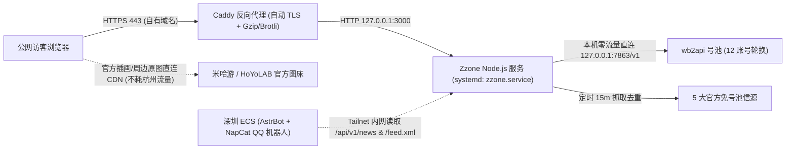

# Zzone 正式版公网部署、号池加固与 AstrBot 联动初步规划

> **状态**：已归档为初步规划（待「正式版 v1」定稿并提供域名后执行上线）  
> **适用宿主机**：阿里云华东 1（杭州）ECS（与 `wb2api` 号池同机）  
> **访问形态**：方案 B（公网域名 + 自动 HTTPS）  
> **部署方式**：方式 1（通过 SSH 远程自动化部署 + `systemd` 托管）

---

## 1. 整体架构与网络拓扑

将 Zzone 部署在**杭州号池宿主机**上，与 `wb2api` 同机运行：后端零延迟直连本机 `http://127.0.0.1:7863/v1`（不走 Tailscale 公网出流、不产生 EIP 流量费），对外通过 Caddy 绑定域名并自动签发 HTTPS 证书；同时预留同 Tailnet 内网通道，供深圳机上的 AstrBot / NapCat 读取情报做 QQ 群推送。

### 核心选型理由

| 维度 | 杭州机部署方案 | 优势说明 |
|---|---|---|
| **资源占用** | 原生 Node.js + `systemd`，不装 Docker | Zzone 常驻内存约 50 MB、产物 < 1 MB，杭州机余量充足（1.2 GB 内存、88% 空闲磁盘） |
| **号池通信** | `http://127.0.0.1:7863/v1` | 同机回环零延迟、零 EIP 流量费，且不暴露号池 Key 到公网 |
| **流量成本** | 图片全走官方 CDN 直连 + Gzip + 强缓存 | 单次首屏加载约 180 KB，二次访问近乎 0 流量，几乎不增加 EIP 按流量计费支出 |
| **隔离原则** | 独立于深圳机 QQ 机器人 | 避免占用深圳机紧张的内存与磁盘，双方通过 Tailnet 轻耦合联动 |

---

## 2. 上线前必须完成的代码加固（正式版 v1 准备阶段）

因采用**方案 B（公网开放）**且杭州号池仅有**单把全局 API Key（无上游配额隔离）**，上线前必须在 Zzone 后端补齐以下防线：

### 2.1 LLM 号池防刷、分级省积分与记账（`server/llm.mjs` & `server/pool.mjs`）
- **并发与速率硬限制**：落实真实安全阈值 `maxInFlight: 3`（全局并发槽位队列）与 `rateLimitPerMin: 20`。
- **公网防刷网关**：
  - 对 `/api/v1/ai/search` 实施 **单 IP 频率限制**（如每分钟 3 次、每日 20 次）+ **全站每日 AI 调用硬上限**；
  - 对 `/api/v1/ai/enrich`、`/api/v1/sync`、`/api/v1/ingest` 等管理/批量写入接口强制要求服务端 `ADMIN_TOKEN` / `INGEST_TOKEN` 鉴权，公网访客不可随意触发批量烧分；
  - 可选增加轻量访客口令开关（按需开启）。
- **模型分级与自动容灾**：
  - 后台定时批量新闻归类/摘要：优先走免费模型 `cn:hy4flash-free`（0 积分成本）；
  - 前台用户实时搜索速报：走主力 `cn:deepseek-v4.1-flash`，遇 429 / 超时 / 5xx 自动降级切换 `cn:glm-5.3-flash`；
  - 代码层明确禁调图片/视频烧分模型（`hunyuan-image-*`、`kling-video-*`、`minimax-video-*`）。
- **返回体净化与积分记账**：
  - 严格仅读取 `choices[0].message.content`，过滤可能残留的 `<think>...</think>` 块，绝不把 `reasoning_content` 拼入正文；
  - 累计记录号池返回的 `usage.credit` 并在状态面板展示，同时兼容 `POOL_LLM_BASE_URL` / `POOL_LLM_API_KEY` 环境变量。

### 2.2 公网省流量与安全头（`server/index.mjs`）
- 启用静态资源与 API 响应的 Gzip 压缩；
- 对 Vite 带指纹产物（`/assets/*`）下发 `Cache-Control: public, max-age=31536000, immutable`；
- 默认监听 `127.0.0.1:3000`（不直接裸露 Node 端口给公网，全部流量经由 Caddy 进入）；
- `server/pool.json` 权限锁定为 `chmod 600`，仅运行用户可读，绝不进入仓库或前端包。

---

## 3. 杭州机公网部署与域名接入清单（方式 1 执行流程）

待「正式版 v1」定稿且你提供域名后，按以下步骤一次性上线：

### 3.1 你需要提前准备的 3 项前提
1. **域名与解析**：提供一个域名（如 `zzone.<your-domain>`），并在 DNS 后台添加一条 `A` 记录指向杭州机公网 EIP（注：国内阿里云 ECS 走 80/443 端口需确认该域名已完成中国大陆 ICP 备案；如未备案可改用海外反代/Cloudflare 隧道或高位端口方案）。
2. **阿里云安全组放行**：在杭州机安全组新增入方向规则放行 `TCP 80`（ACME 证书校验与 HTTP→HTTPS 自动跳转）和 `TCP 443`（HTTPS）。
3. **SSH 授权确认**：确认本机可免密登录杭州机的 SSH 别名（如 `~/.ssh/config` 中配置）。

### 3.2 服务器落地目录与服务配置
- **部署路径**：`/opt/zzone/`（与 `/opt/wb2api/` 保持一致的目录风格）
  - `/opt/zzone/app/`：Git 仓库代码与构建产物 `dist/`
  - `/opt/zzone/pool.json`（或软链至 `server/pool.json`，`chmod 600`）：指向 `http://127.0.0.1:7863/v1`
  - `/opt/zzone/data/`：持久化 `store.json` 与 `ai-cache.json`
- **运行环境**：安装 Node.js LTS（v22）+ `pnpm` + 轻量反代 **Caddy**（单二进制、零复杂配置、自动续签 Let's Encrypt HTTPS 证书并自带 Brotli/Gzip）。
- **Systemd 守护**：`/etc/systemd/system/zzone.service`
  - `Restart=always`，开机自启，绑定 `HOST=127.0.0.1 PORT=3000`，日志统一归入 `journalctl -u zzone`。
- **Caddy 站点配置**（`/etc/caddy/Caddyfile`）：
  - 仅反代 Zzone 域名到 `127.0.0.1:3000`，同时附加请求速率与基础安全响应头；
  - 与 `tailscale serve`（占用 Tailnet 域名的号池反代）完全解耦，互不冲突。
- **一键发版更新脚本**：`/opt/zzone/update.sh`
  - 拉取指定 GitHub Release 标签 → 安装依赖并构建 → `systemctl restart zzone` → 健康检查 `/api/v1/status`。

### 3.3 上线必测验收项
1. **同机号池连通测试**：验证 `127.0.0.1:7863/v1` 响应延迟、免费模型与主备模型降级、`usage.credit` 记账；
2. **5 大官方信源实测**：在杭州机实测国服官网、米游社、HoYoverse 国际官网、HoYoLAB、日服官网的抓取成功率与超时兜底，确认国际源偶发抖动不会阻塞服务；
3. **公网 HTTPS 与压测**：验证域名证书自动签发、单 IP 限流拦截生效、无密钥泄露、二次刷新走强缓存；
4. **社交号池预留位**：B站 / 微博 / X 保持 `enabled: false` 占位，后续拿到 Cookie 或接入外部 `POST /api/v1/ingest` 随时热启用。

---

## 4. 后期联动彩蛋规划：深圳机 AstrBot × 杭州机 Zzone

> 待 Zzone 正式版在杭州机稳定运行后，可按需开启此阶段，实现「网页聚合站 + QQ 群机器人」双端联动。

- **内网直连架构**：杭州机通过 Tailnet 内网暴露只读端口（或复用 Tailnet 内网 IP + 只读路径），深圳机上的 AstrBot 无需走公网即可定时轮询 Zzone：
  - **新兑换码秒推**：监听有效兑换码列表变更，第一时间推送到指定 QQ 群并附一键复制文本与截止时间；
  - **大版本/卡池/活动播报**：轮询 `/api/v1/news` 与 `/feed.xml`，仅推送高优先级官宣（新版本前瞻、杭州 FES / ZLIVE 开票、重磅周边截单提醒），利用 Zzone 已做好的跨源去重引擎避免 QQ 群刷屏；
  - **群内按需问答**：在 QQ 群 `@机器人 查绝区零 3.4` 或 `查周边`，由 AstrBot 直接检索 Zzone 聚合库并调用同套号池生成精准速报。

---

## 5. 服务器运维防坑备忘

1. **防欠费断网**：杭州机余额目前较低，公网开放前建议充值并开启阿里云余额告警（如低于 ¥30 短信提醒），避免余额归零导致 EIP 断网引发号池与网站同时失联。
2. **数据定时备份**：后续可将 `/opt/zzone/data/` 与 `/opt/wb2api/data/` 一并纳入每日 `rsync` 备份（同步至深圳机或本地 Mac）。
3. **公网安全边界**：绝不把 `wb2api` 的 `7863` 端口或管理面板暴露到公网；公网仅暴露 Zzone 域名经 Caddy 反代后的入口。
